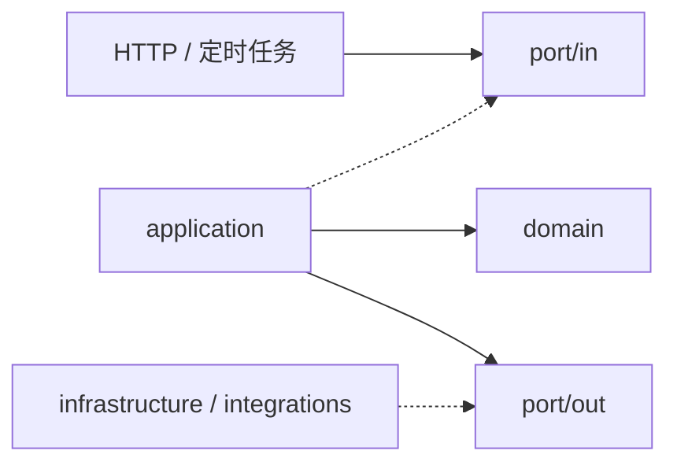

# 架构与开发

[首页](../README.md) · [配置](configuration.md) · [运维](operations.md) · **架构** · [模块](modules.md)

项目采用模块化单体，以 DDD 表达业务规则，通过 ports/adapters 隔离流程与技术实现。

[模块职责](#模块职责) · [依赖方向](#依赖方向) · [分层示例](#分层示例) · [开发检查](#开发检查)

## 依赖方向

实线表示依赖，虚线表示实现接口。



| 层 | 责任 |
| --- | --- |
| `domain` | 业务模型、校验、费用和状态决策；仅依赖 JDK、领域类型与 `shared.Hashing` |
| `port/in` | 对外用例与请求、结果类型，由 application 实现 |
| `port/out` | 仓储、外部能力、快照编解码和只读配置的契约 |
| `application` | 加载状态、调用领域行为、组织流程、保存结果，安排事务和锁 |
| `infrastructure` | SQL 映射、配置绑定、序列化、资源加载与运行装配 |
| `interfaces` | HTTP 参数校验、调用入站 port、映射响应 |
| `integrations` | 外部协议、鉴权、传输和解析，实现业务模块的出站 port |

domain 不访问数据库、HTTP、Spring 或 JSON 库。application 保留 Spring 装配与事务支持，通过 port 使用其他能力；Controller、定时任务和模块间协作也依赖 port。

application 可以根据领域返回结果决定下一步流程；资格校验、费用计算、状态转换权限等规则由 domain 决定。

## 模块职责

代码位于 [com/globalnewsflash](../src/main/java/com/globalnewsflash)，每个模块按上述层次组织。完整调用链、主要入口、数据所有权和验证边界见[模块与链路导航](modules.md)；各模块与外部接入子包的 `package-info.java` 提供就近说明。

| 模块 | 业务职责 |
| --- | --- |
| `ingestion` | 来源注册与准入、素材版本身份、待办状态和重试 |
| `editorial` | 证据链、时效、题材与风险检查，稿件复验和模型费用估算 |
| `publication` | 发布意图、修订约束、确认历史、渠道频率与投递核对 |
| `digest` | 已发布新闻的筛选、窗口、长度及日报快照一致性 |
| `automation` | 预算、编辑任务、运营就绪条件与告警规则，编排主处理流程 |
| `growth` | 合成内容、目标授权、幂等与邀请归因，仅用于离线演示 |
| `integrations` | 来源、AI、Telegram 与 Webhook 协议适配及公共 HTTP 传输 |
| `shared` | 稳定哈希、快照编解码契约与 JSON 适配 |

来源注册归 ingestion 所有，其他模块通过 `SourceRegistry` 读取准入声明。业务快照归入所属 domain，用例结果定义在入站 port 中。

外部接入集中在 `integrations/ai`、`sources`、`telegram` 和 `webhook`；公共 HTTP 传输放在 `integrations/http`。接入实现负责协议处理，业务上的准入、预算和重试决定留在领域中。

## 分层示例

以 publication 为例，目录与职责对应如下：

```text
publication/
  domain/           PublicationOperation、PublicationPolicy、ChannelLimit
  port/
    in/             PublicationUseCase
    out/            PublicationRepository、DeliveryGateway、PublicationGuard
  application/      PublicationService
  infrastructure/   MyBatis 映射、运行配置、调度与合成投递
  interfaces/       PublicationController
```

一次发布请求按以下职责流转：

1. `PublicationController` 校验 HTTP 参数，通过 `PublicationUseCase` 调用用例。
2. `PublicationService` 加载状态，调用 `PublicationPolicy`、`ChannelLimit` 做领域决策。
3. 用例通过 `PublicationRepository` 保存意图、尝试和结果，安排事务与锁。
4. 需要真实投递时调用 `DeliveryGateway`，具体协议由 `TelegramDeliveryGateway` 实现。

其他模块按实际需要采用同样的分层，不建立没有用途的空层。对外契约放在 `port`，MyBatis Mapper 作为技术适配接口留在 infrastructure，SQL 注解不进入 port。

## 事务与故障边界

- **模型调用**：先提交任务与预算预占，再发起请求，最后在新事务中结算；数据库锁不跨越 HTTP 调用。
- **发布投递**：先提交 SENDING，再调用投递 port；结果不明进入 UNKNOWN，由人工核对。
- **原子入队**：事件或日报快照与发布任务在同一事务中提交，仓储保留唯一键、锁与 CAS 语义。
- **分批采集**：不可变快照、整批待办与分页进度一起提交，完整快照处理后再推进游标。

MyBatis Mapper 直接实现仓储 port；`JacksonSnapshotCodec` 实现 `SnapshotCodec`。SQL、JSON 和外部客户端不进入领域层。

模型超时后的预算核对、投递 UNKNOWN 后的消息核对属于两条独立恢复流程。application 负责协调步骤，领域保留各自状态规则；人工操作入口见[费用与投递核对](operations.md#费用与投递核对)。

## 开发检查

在项目根目录执行：

```powershell
.\mvnw.cmd -B -ntp clean verify
```

[ArchitectureTest](../src/test/java/com/globalnewsflash/architecture/ArchitectureTest.java) 检查领域依赖、port 独立性、入口和 application 对具体实现的隔离。领域测试验证规则，集成测试验证事务、去重、鉴权与恢复。

修改代码时按职责选择位置：

| 变更 | 实现位置 |
| --- | --- |
| 新增业务规则、状态或计算 | 所属 domain，并补充领域测试 |
| 新增公开用例 | `port/in` 声明，application 编排 |
| 新增仓储或外部能力 | `port/out` 声明，由适配器实现 |
| 新增供应商 | 对应 integrations 包，实现已有出站 port，并补充模拟请求测试 |
| 新增配置 | infrastructure / integrations 绑定；领域接收明确的输入 |
| 修改数据库结构 | 在 `db/migration` 追加新版本，不合并或重写已执行迁移 |

## 离线演示

按首页构建运行包后，可运行固定时钟下的合成场景：

```powershell
java -jar .\target\global-news-flash-0.1.0-SNAPSHOT.jar `
  --spring.profiles.active=offline,demo `
  --spring.main.web-application-type=none `
  --news.demo.enabled=true `
  --news.runtime.mode=OFFLINE `
  --news.runtime.external-enabled=false
```

演示输出 `SYNTHETIC_DEMO_RESULT` 后退出，使用合成数据，不调用真实外部服务。
