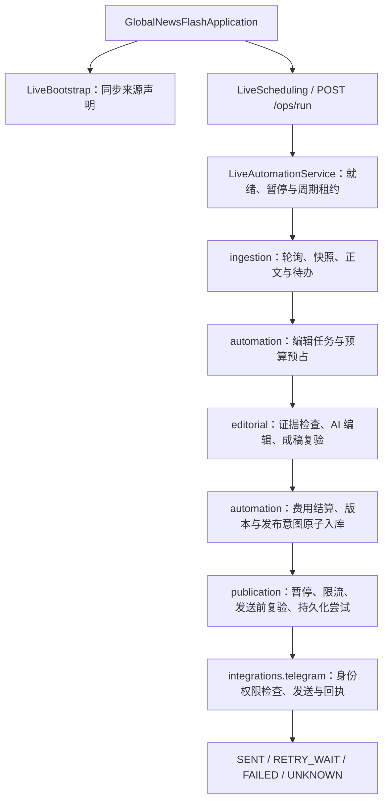

# 模块与链路导航

[首页](../README.md) · [配置](configuration.md) · [运维](operations.md) · [架构](architecture.md) · **模块**

项目是一个进程内的模块化单体。模块不需要分别启动；统一由 [GlobalNewsFlashApplication](../src/main/java/com/globalnewsflash/GlobalNewsFlashApplication.java) 启动。数据库、运行模式和执行开关见[运行模式](configuration.md#运行模式)。

每个一级模块和外部接入子包的 `package-info.java` 提供贴近代码的职责、入口和故障边界；本页用于串起模块、数据和阅读路径。

## 主链路

这表示模块协作，不表示每次触发都会发送消息。暂停、无有效素材、预算不足、旧闻、风险审查和修订策略都可能使本轮跳过或挂起；`COMPLETED` 只表示本轮流程结束。

`LiveBootstrap` 只同步声明。定时任务由 `news.automation.enabled` 控制；`live` 的默认首次检查延迟为 10 秒，每轮结束后间隔 60 秒。全局暂停是数据库状态，初始为 `true`，重启保留。手动采集可在暂停期间执行；主循环与消息发送继续检查暂停。

## 模块总览

| 模块与代码说明 | 职责与主要阅读入口 | 数据所有权 |
| --- | --- | --- |
| [ingestion](../src/main/java/com/globalnewsflash/ingestion/package-info.java) | 来源准入、快照进度和待办；`LiveIngestionService` | `news_source`、`ingestion_source_state`、`ingestion_inbox` |
| [editorial](../src/main/java/com/globalnewsflash/editorial/package-info.java) | 证据资格、模型编辑和成稿复验；`EditorialService`、`EditorialRules` | 无独立业务表，返回编辑决策和稿件 |
| [automation](../src/main/java/com/globalnewsflash/automation/package-info.java) | 主循环、事件版本、编辑任务、预算与告警；`LiveAutomationService`、`LivePipelineService` | `news_material`、`news_event*`、`news_audit`、`live_editor_job`、`budget_*`、`automation_*`、`ops_notification` |
| [publication](../src/main/java/com/globalnewsflash/publication/package-info.java) | 发布队列、投递、暂停、限流与人工核对；`PublicationService` | `publication_*` |
| [digest](../src/main/java/com/globalnewsflash/digest/package-info.java) | 已确认新闻的日报快照与复验；`DigestService`、`DigestEvidenceValidator` | `news_digest` |
| [growth](../src/main/java/com/globalnewsflash/growth/package-info.java) | 合成推广、授权目标和邀请归因；`GrowthService` | `growth_*`，仅离线演示 |
| [integrations](../src/main/java/com/globalnewsflash/integrations/package-info.java) | 供应商协议、鉴权、传输和响应解析 | 无独立业务表，使用所属模块的 port |
| [shared](../src/main/java/com/globalnewsflash/shared/package-info.java) | 稳定哈希与快照编解码契约；`Hashing`、`SnapshotCodec` | 无独立业务表 |

业务模块内部的 `domain`、`port/in`、`port/out`、`application`、`infrastructure` 和 `interfaces` 规则见[依赖方向](architecture.md#依赖方向)。接口在 port，事务与步骤在 application，规则在 domain，SQL 在 infrastructure。

## ingestion：来源与素材

从 [LiveIngestionService](../src/main/java/com/globalnewsflash/ingestion/application/LiveIngestionService.java) 阅读 `syncSources → poll → pending → complete/retry`。配置目录由 `ConfiguredSourceCatalog` 提供，其他模块通过 `SourceRegistry` 读取或锁定来源声明。

启用来源不等于批准素材：还检查许可证版本、生产者、合成/真实模式。运维禁用过的来源不会被周期同步自动重新启用。素材版本身份排除再次发现时间，避免把重复发现当成新版本。

采集先冻结 feed，再按页提取素材，网络请求不占用数据库事务。正常素材、逐篇失败记录和进度在同一事务提交；失败文章在同一快照中最多尝试三次，之后隔离并推进，重启保留次数。失败记录可通过 `/ops/ingestion/failures` 查看，排查见[来源快照停滞](operations.md#来源快照停滞)。

## editorial：证据与稿件

从 [EditorialService](../src/main/java/com/globalnewsflash/editorial/application/EditorialService.java) 进入，主要规则在 [EditorialRules](../src/main/java/com/globalnewsflash/editorial/domain/EditorialRules.java)。调用前检查来源、时效、题材、证据链和风险；调用后检查结构化语句、引用、数字、语言与长度。

`EditorPort` 屏蔽供应商，`ModelPricing` 提供配置就绪与费用估算；编辑模块不自行持久化预算或直接发布。发送前用保存的材料、规则和稿件重新校验，不再次调用模型。引用与数字验证不能证明整句话语义正确，跨来源事实核实也尚未实现。

## automation：编排、预算与运维

从 [LiveAutomationService.runOnce](../src/main/java/com/globalnewsflash/automation/application/LiveAutomationService.java) 看一轮流程，从 [LivePipelineService](../src/main/java/com/globalnewsflash/automation/application/LivePipelineService.java) 看单个事件的准备、模型调用和完成阶段。`PipelineService`、`DemoService` 为合成离线路径。

模型请求前提交 `EDITING` 任务和预算预占；请求结束后结算费用。事件决策与发布意图原子提交。超时或进程中断时保留不确定预算，不自动重做可能已计费的同一请求；人工费用核对与申请新请求见[费用与投递核对](operations.md#费用与投递核对)。

`OpsController` 提供状态、暂停、采集和执行入口，`ReportController` 汇总记录；`OpsNotificationService` 将本地告警转为可选 Webhook 通知。`ready=true` 是本地配置检查，不能证明模型额度、远端可达性和频道权限。

## publication：发布与回执

从 [PublicationService](../src/main/java/com/globalnewsflash/publication/application/PublicationService.java) 阅读 `enqueue → dispatch → finish`，运维入口在 `PublicationController`。

常规状态为 `PENDING → CLAIMED → SENDING → SENT`。限流进入 `RETRY_WAIT`；资格撤销进入 `CANCELLED`；明确失败进入 `FAILED`；含糊结果或发送租约过期进入 `UNKNOWN`。发送前检查暂停、证据版本、来源声明、已结算费用、目标频道和频率限制。

`SENDING` 和尝试记录先提交，再调用投递网关。`UNKNOWN` 必须核对实际频道与尝试记录；确认未发送后任务结束，不自动重发。业务幂等键不能提供远端“恰好一次”保证。

## digest：日报

从 [DigestService](../src/main/java/com/globalnewsflash/digest/application/DigestService.java) 阅读到期窗口、候选选择和原子入队，从 `DigestEvidenceValidator` 阅读已发布新闻的当前资格复验。

日报重用已确认发布的完整简报，不新增 AI 请求。每个 UTC 日期和目标频道有唯一快照，仍经 publication 投递。默认关闭；日报领域规则已有测试，但完整服务、SQL 与并发编排仍需专项回归。

## growth：合成推广

从 [GrowthService](../src/main/java/com/globalnewsflash/growth/application/GrowthService.java) 阅读目标授权、幂等模拟分发与已知/未知邀请归因。

当前没有真实推广、创建邀请或订阅回调客户端。报表中的 `growth` 属于合成结果，阅读量与订阅变化仍为 `UNKNOWN`；不能据此判断真实增长或收入。

## integrations 与 shared：技术边界

| 接入子包 | 主要入口 | 扩展时保留的边界 |
| --- | --- | --- |
| [sources](../src/main/java/com/globalnewsflash/integrations/sources/package-info.java) | `ConfiguredSourceCollector`、`LiveSourceCollector`、各来源 adapter | 主机白名单、有界响应、无重定向；GDELT 仅发现；来源批准仍归 ingestion |
| [ai](../src/main/java/com/globalnewsflash/integrations/ai/package-info.java) | `OpenAiEditor`、`DeepSeekEditor`、`AiProviderSettings` | 结构化响应和 usage 校验；明确拒绝与不确定计费区分；预算归 automation |
| [telegram](../src/main/java/com/globalnewsflash/integrations/telegram/package-info.java) | `TelegramDeliveryGateway`、`TelegramPublicationGuard` | Bot/频道/权限预检、目标与消息回执一致性、429 退避、UNKNOWN 冻结 |
| [webhook](../src/main/java/com/globalnewsflash/integrations/webhook/package-info.java) | `WebhookNotificationGateway` | 只发通知 ID 与原因码；至少一次投递，接收方按 ID 去重 |
| [http](../src/main/java/com/globalnewsflash/integrations/http/package-info.java) | `BoundedBodySubscriber` | 完整响应与字节上限，不承担业务重试策略 |

`shared.Hashing` 提供纯计算；`SnapshotCodec` 让应用服务不依赖 JSON 库，`JacksonSnapshotCodec` 是适配实现。模块专有规则和外部客户端应留在所属模块。

## 从问题定位入口

| 现象或修改目标 | 先看哪里 |
| --- | --- |
| 服务启动、Profile 或连接参数 | [首页启动说明](../README.md#本地启动)、[运行配置](configuration.md) |
| 服务 UP 但没有自动处理 | `/ops/status` 的 `paused` 和 `/ops/automation` 的 `ready/reasons` |
| 无新素材或同一来源反复失败 | `/ops/ingestion`，再看 `LiveIngestionService` 与来源 collector |
| 素材挂起、旧闻或引用不通过 | `/ops/ingestion/inbox`、`/ops/events`，再看 `EditorialRules` |
| 模型请求或费用不确定 | `/ops/editor-jobs`，再看 `LivePipelineService`、`BudgetService` |
| 重复、限流、UNKNOWN 或需要核对 | `/ops/publications` 及 attempts/resolutions，再看 `PublicationService` |
| 新增来源或供应商 | 定义已有 port 的 adapter，并保留准入、费用、投递门禁 |

## 验证边界

现有自动化覆盖领域规则、合成主链路、发布状态机、鉴权，以及部分 AI/HTTP/Webhook 协议。入口包括 [PipelineIntegrationTest](../src/test/java/com/globalnewsflash/automation/PipelineIntegrationTest.java)、[PublicationServiceTest](../src/test/java/com/globalnewsflash/publication/PublicationServiceTest.java) 和 [ArchitectureTest](../src/test/java/com/globalnewsflash/architecture/ArchitectureTest.java)。

`PipelineIntegrationTest` 走合成 `PipelineService`，不等于 LIVE 编排回归。`IntegrationWiringTest` 验证真实 adapter 的装配，但关闭外部访问。LIVE 采集持久化、编辑编排、主调度和 Telegram 传输仍缺少直接的服务/协议回归；H2 测试不能替代 MySQL 锁、事务与恢复验证。

真实来源持续运行、模型实际账单、频道实际消息与恢复演练需要另外验收。当前没有仓库内备份/恢复脚本或业务表保留期清理任务。历史评审和验证记录保留在项目外的 `global-news-flash-archive`，本页只维护当前实现事实。
